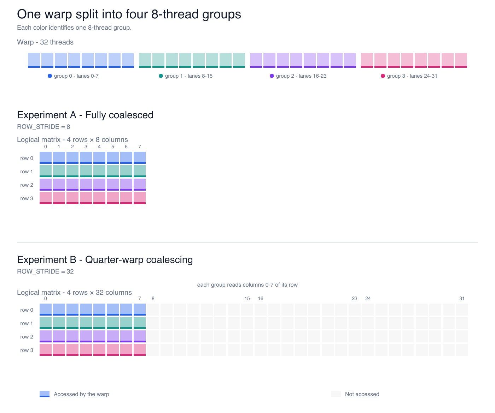

# Coalesced Submatrix Load

Small CUDA benchmark for comparing coalesced warp loads from strided `float`
submatrices. It supports 8- and 16-thread groups, validates every result, and
reports kernel runtime and useful bandwidth.



## Build

Requirements: CUDA Toolkit with `nvcc` and an NVIDIA GPU. Set `CUDA_ARCH` to
the GPU's compute capability without the decimal point (`86` for RTX 3060,
`80` for A100, `90` for H100).

```bash
CUDA_ARCH=86 ./build.sh
```

If `nvcc` is not on `PATH`, set it explicitly:

```bash
NVCC=/path/to/nvcc CUDA_ARCH=86 ./build.sh
```

## Run

Run every stride for the default 8-thread group:

```bash
./build/coalesced-submatrix-load
```

Run one configuration:

```bash
./build/coalesced-submatrix-load --thread-group-size 8 --row-stride 32
```

Valid group sizes are `8` and `16`. Valid row strides are `8`, `16`, `32`,
and `all`; group size 16 supports strides 16 and 32.

## Profile with Nsight Compute

```bash
mkdir -p reports
ncu --set full --clock-control none --nvtx --nvtx-include 'ProfileRange/' \
  -o reports/coalesced-submatrix-load \
  ./build/coalesced-submatrix-load --row-stride 32 --ncu
```
